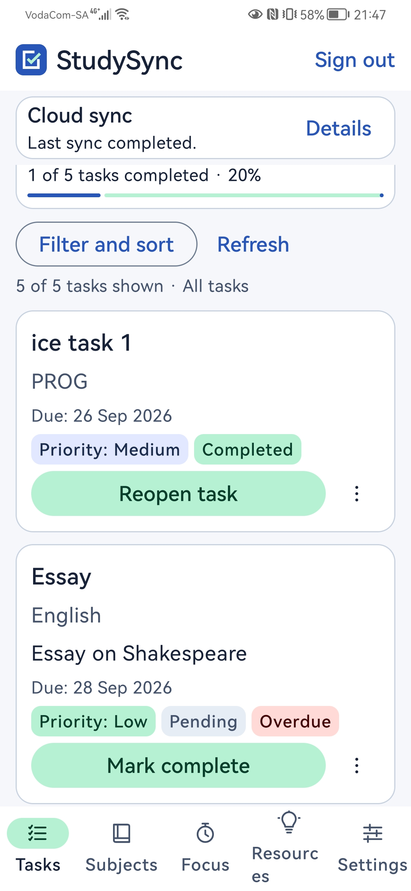
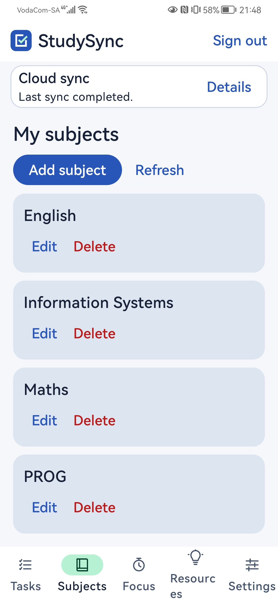
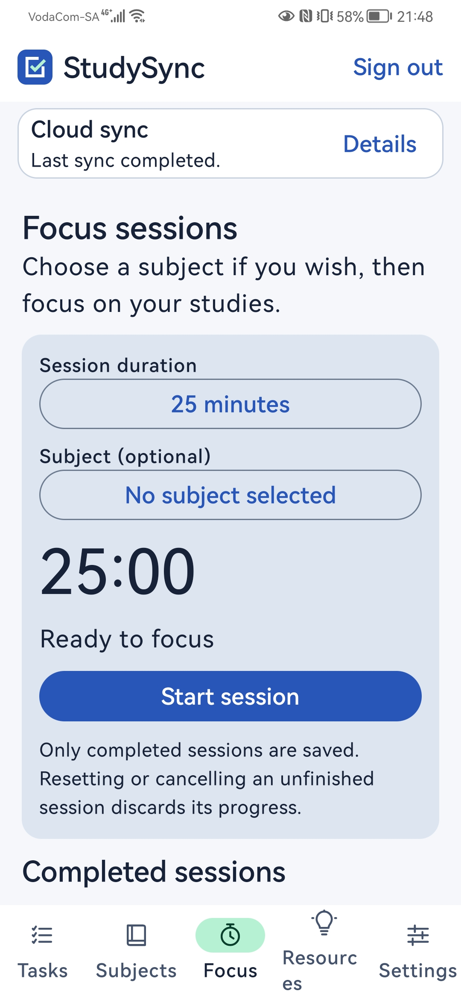
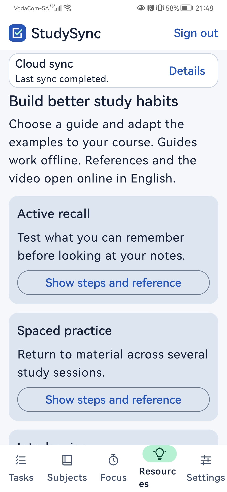
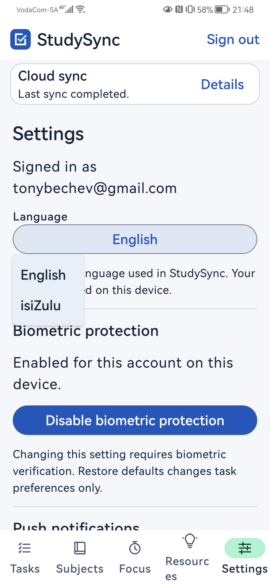
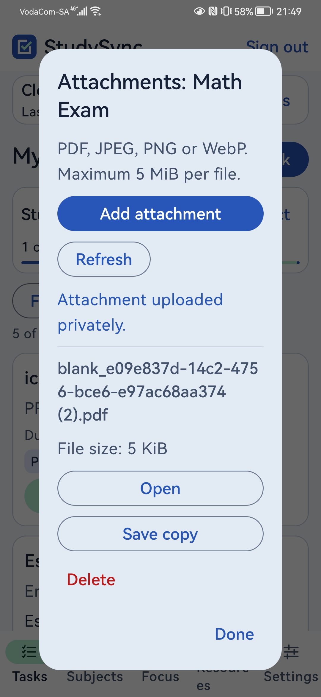
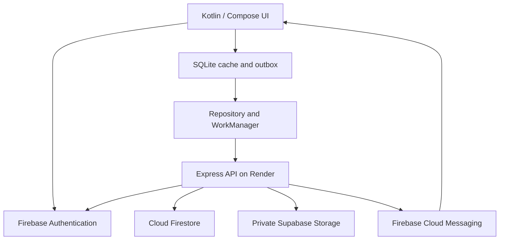

# StudySync - Final POE

**Project by:**

- **Antonio Bechev - ST10435330**
- **Sive Sikutshwa - ST10061605**

Native Android study planner for **PROG7314 Part 3**, version **2.0.0** (version code 2). StudySync helps students organise subjects, prioritise tasks, track progress and practise effective study habits.

[Repository](https://github.com/ST10435330/PROG7314_POE_Part_3) | [Build and test results](https://github.com/ST10435330/PROG7314_POE_Part_3/actions) | [API health](https://prog7314-poe-part-2.onrender.com/api/health) | [Releases](https://github.com/ST10435330/PROG7314_POE_Part_3/releases)

**Final demonstration video:** [Watch the StudySync application and backend demonstration](https://youtu.be/2jKkpYxGkFw)

**Signed APK:** Built, signature verified and installed on a physical Huawei phone. Upload `app-release.apk` to the final GitHub Release and link that release here before submission. Google Play publication has not been claimed.

## Application screenshots

| Tasks | Subjects |
| --- | --- |
|  |  |

| Focus sessions | Study resources |
| --- | --- |
|  |  |

| isiZulu settings | Private attachments |
| --- | --- |
|  |  |

[Additional resource screenshot](docs/screenshots/resources2.jpg)

## Features and assessment coverage

| Requirement | Implementation |
| --- | --- |
| Native physical-device application | Kotlin, Jetpack Compose and Material 3; minimum Android 8.0/API 26, target API 36. |
| Single Sign-On | Google sign-in through Firebase Authentication; first sign-in creates the account, with returning login and sign-out. |
| Native biometrics | Android BiometricPrompt with strong biometrics and an Android Keystore CryptoObject. Supported fingerprint or face hardware must be enrolled. |
| Offline actions and synchronisation | Per-account SQLite subject/task cache and persistent outbox; WorkManager synchronises when connected. |
| Custom REST API | Express on Render verifies Firebase ID tokens, validates requests and scopes data to the authenticated user. |
| NoSQL reads and writes | Cloud Firestore stores subjects, tasks, attachment manifests and sync receipts through the API. |
| Blob storage | Private Supabase Storage files uploaded, downloaded and deleted through the authenticated API. |
| Live push notifications | Firebase Cloud Messaging, device registration, notification permission handling, test alerts and task-change alerts. |
| South African languages | English and isiZulu, with a saved language preference and translated screens, validation and errors. |
| Settings | Saved default task priority and sorting, language, biometric and notification controls. |
| Core study features | Subjects, task creation/editing/deletion, priorities, due dates, overdue indicators, filtering, sorting, completion and progress. |
| Additional final features | Focus timer with completed-session history; research-referenced study resources and an external educational YouTube video. |
| Production assets | Custom application icon, consistent blue/mint theme, bottom navigation and physical-device screenshots. |
| DevOps | Preserved repository history; GitHub Actions builds, tests and lint checks. Final submission will use an annotated Final-POE tag. |

## Three custom features

These features extend the core subject and task planner in the final application:

### 1. Task attachments

Students can attach PDF documents and supported images to individual tasks, keeping assignment instructions, notes and reference material with the relevant work. Files can be uploaded, opened, exported and deleted. Attachment bytes are stored in private Supabase Storage and accessed through the Firebase-authenticated REST API; metadata is stored in Firestore.

### 2. Focus timer and session history

Students can run timed study sessions, optionally associate them with a subject, and pause, resume, reset or cancel the timer. Completed sessions appear in account-separated local SQLite history, helping students review their completed study time. Focus history is stored on the device and is not cloud-synchronised.

### 3. Study Resources

The Study Resources tab provides English and isiZulu guides on retrieval practice, spaced practice, interleaving and self-explanation. Offline guide text includes practical suggestions, research citations and reference links. A credited educational YouTube video opens externally, and an Open Focus shortcut connects the advice to a study session. External references and the video require internet access.

## Architecture and design considerations



Compose screens handle interaction; repositories coordinate persistence and network operations. Firebase ID tokens identify the user. The API derives ownership from the verified token rather than trusting a user ID supplied by Android. Firebase remains responsible for authentication, Firestore data and FCM; **Supabase is used only for attachment file storage**.

SQLite retains local study changes across restarts. Immutable operation IDs and server receipts make retries idempotent; version checks protect newer edits from stale responses. Rejected changes remain visible for correction. Network failures retain pending work. Automatic synchronisation follows Android background scheduling and is not guaranteed to run immediately on reconnection. Settings are device-local.

Biometrics protect an existing account session. Normal backgrounding locks the app. An app-launched attachment picker can resume the same unlocked account once within two minutes; screen-off, account changes, expiry or activity recreation require unlocking again.

The interface uses readable task badges, compact sync status, scrollable details and translated error/retry feedback. Logcat entries tagged `StudySync` record lifecycle events, biometric state, synchronisation and notification operations. Credentials and tokens must remain private.

## Attachment behaviour

PDF, JPEG, PNG and WebP files are limited to **5 MiB**. Android and the API validate uploads. File bytes stay in the private `task-attachments` bucket; metadata/manifests stay in Firestore. The server secret is never shipped in the APK. Because the server uses privileged Supabase credentials, its Firebase authentication and ownership checks enforce access.

Uploads preserve their UUID on retry. Downloads use private cache; opening a file grants temporary read-only FileProvider access. Save copy exports to a user-selected location. Task deletion schedules retryable attachment cleanup after the task deletion is acknowledged.

A newly created offline task must sync before accepting uploads. Cached attachments can open offline; new uploads and uncached downloads need connectivity. There is no persistent background upload queue. See [storage setup and endpoint details](server/SUPABASE_STORAGE.md).

### Storage provider decision

Firebase Storage was originally planned for attachments, but activating the Blaze billing plan required a payment that could not be funded within the student project budget. We therefore migrated attachment file storage to Supabase so the feature could be completed and demonstrated.

Only attachment file bytes moved to Supabase. Firebase Authentication, Cloud Firestore and Firebase Cloud Messaging remain in use. Attachments still pass through the authenticated REST API, with ownership checks and a private storage bucket. The attachment feature is functional and does not depend on activating Firebase Blaze.

Historical `storage.rules`, `tests/storage` and their workflow cover the retired Firebase Storage provider, not the current Supabase access path.

## Setup and verification

Requirements: Android Studio, JDK 17+, Android SDK 36, Node.js 24 and a physical Android phone with Google sign-in support.

```powershell
git clone https://github.com/ST10435330/PROG7314_POE_Part_3.git
cd PROG7314_POE_Part_3
powershell -NoProfile -ExecutionPolicy Bypass -File .\scripts\bootstrap-gradle.ps1
```

1. Enable Google sign-in in the Firebase project and register `com.studysync.app` with the correct debug/release signing fingerprints.
2. Place the updated configuration at `app/google-services.json`. For CI, put its full contents in the repository secret `GOOGLE_SERVICES_JSON`.
3. Open the project in Android Studio and sync Gradle. The API base URL is set in `StudyApi.kt`; the existing Part 2 hostname is intentional.
4. For the backend, run `npm ci` inside `server`, copy `.env.example` to `.env`, and configure `GOOGLE_APPLICATION_CREDENTIALS`, `SUPABASE_URL`, `SUPABASE_SECRET_KEY` and `SUPABASE_ATTACHMENT_BUCKET`. Use `PORT=3000` locally, then `npm start`.
5. Render uses root directory `server`, build command `npm ci` and start command `npm start`. Configure credentials through Render secrets/environment. Keep the bucket private and direct Firestore client access denied.

Run from the repository root:

```powershell
.\gradlew.bat :app:assembleDebug :app:testDebugUnitTest :app:lintDebug
npm ci --prefix server
npm test --prefix server
```

Android tests cover validation, SQLite, synchronisation, biometrics picker policy, notifications, language resources, focus sessions and attachment handling. MockWebServer tests exercise HTTP authentication, cancellation and malformed responses. Backend tests cover validation, authentication, user scoping, sync retries, notifications and attachments. Automated tests do not replace live infrastructure or physical-device testing.

`android.yml` runs debug assembly, unit tests and lint, uploading reports. `backend.yml` installs locked dependencies and runs Node tests. Both run on pushes and pull requests. CI verifies code; Render deployment and production APK signing are separate steps. Check the actual latest workflow results through the Actions link above.

## API and stored data

Base URL: `https://prog7314-poe-part-2.onrender.com/api/`

| Route | Purpose |
| --- | --- |
| GET `health` | Public health check. |
| GET/POST `subjects`, `tasks` | List/create study records. |
| PATCH/DELETE `subjects/{id}`, `tasks/{id}` | Update/delete records. |
| PUT `subjects/{id}`, `tasks/{id}` | Offline upserts using X-Operation-Id; offline DELETE also supplies this header. |
| POST `notifications/register`, `notifications/unregister`, `notifications/test` | Device registration and test push. |
| GET `tasks/{taskId}/attachments` | Attachment metadata list. |
| PUT/GET/DELETE `tasks/{taskId}/attachments/{attachmentId}` | Upload/download/delete attachment bytes. |

All data routes require `Authorization: Bearer <Firebase ID token>`. Subjects and tasks use `users/{uid}/subjects/{id}` and `users/{uid}/tasks/{id}`. Attachment manifests use `users/{uid}/attachmentGroups/{taskId}/files/{id}`. Dates remain `YYYY-MM-DD`; priorities remain HIGH, MEDIUM or LOW regardless of display language.

## Release evidence and limitations

On 6 November 2026, the developer reported successful signed-release installation and testing on a physical Huawei phone: Google sign-in restored existing cloud data; biometrics, offline reconnection sync, attachments, notifications, language switching, focus sessions and resources worked.

APK signature verification reported one signer and a valid V2 signature. Certificate SHA-1: `AF:96:8A:C8:C5:FF:A2:74:03:8A:0D:9A:7F:33:AD:2D:B2:68:A1:04`. This is a certificate fingerprint, not an APK file checksum. Keep the keystore and passwords outside Git.

The final demonstration video is linked at the top of this README, and promotional screenshots are included in this repository. Upload the signed APK to the final GitHub Release and add its direct release link before submission. Tag the completed submission commit `Final-POE` only after its code, documentation and evidence are final.

Completed focus history is local and account-separated; it is not cloud-synchronised. Unfinished timers are lost if the process is terminated. The educational video opens externally and needs internet. Cloud availability and notification delivery depend on connectivity and provider availability. File bytes and Firestore manifests are not a distributed transaction; combined failures can require retry or owner intervention. Exported files are outside the app's control. Uninstalling deletes local settings, focus history and unsynchronised data.

## Contributions and declarations

The prototype README recorded Antonio Bechev (ST10435330) for Android/interface/integration work and Sive Sikutshwa (ST10061605) for the custom API and Firestore. Final development and teammate changes are recorded in the preserved commit and merge history.

See [release notes](RELEASE_NOTES.md) and the [AI assistance declaration](AI_DECLARATION.md).

## Technical references

- Android Developers: [Biometric authentication](https://developer.android.com/identity/sign-in/biometric-auth) and [application signing](https://developer.android.com/studio/publish/app-signing).
- Firebase: [Google sign-in](https://firebase.google.com/docs/auth/android/google-signin), [ID token verification](https://firebase.google.com/docs/auth/admin/verify-id-tokens) and [FCM for Android](https://firebase.google.com/docs/cloud-messaging/android/get-started).
- Supabase: [Storage access control](https://supabase.com/docs/guides/storage/security/access-control).
- GitHub: [GitHub Actions](https://docs.github.com/en/actions/get-started/understand-github-actions).
- Research citations and DOI links for each study guide are presented in the Resources screen.
