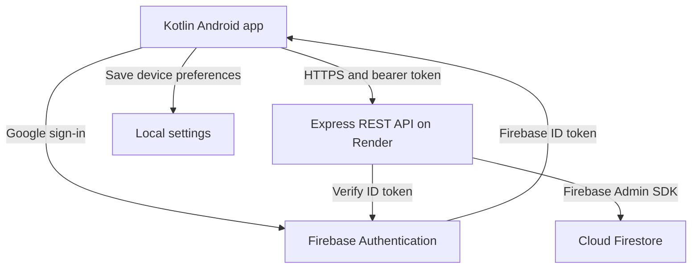

# StudySync

StudySync is a native Kotlin Android study planner for **PROG7314 POE Part 2**. Students sign in with Google, organise subjects, manage study tasks and track completion. A custom REST API hosted on Render stores each user's subjects and tasks in Cloud Firestore.

## Project links

GitHub Repository 		           ->	https://github.com/ST10435330/PROG7314_POE_Part_2

GitHub build and test workflows    ->	https://github.com/ST10435330/PROG7314_POE_Part_2/actions

Hosted API Health check	           ->	https://prog7314-poe-part-2.onrender.com/api/health

YouTube demonstration 	           ->	https://youtu.be/d-Y73tCCgLY

API Video Demonstration	           ->	https://youtu.be/jVKDiaOgvVY


## Group contributions

| Member | Contribution |
| --- | --- |
| Antonio Bechev — ST10435330 | Android application, interface, app features and integration with Firebase Authentication and the hosted API. |
| Sive Sikutshwa — ST10061605 | Created the custom REST API and Cloud Firestore database. |

## Features and rubric coverage

| Part 2 criterion | StudySync implementation or required evidence |
| --- | --- |
| Runs on a mobile device | Native Android app; demonstrate the latest build running on a physical phone. |
| SSO sign-in | Google sign-in through Firebase Authentication; first sign-in creates the account, with returning login and sign-out. |
| Settings menu | Default task priority and sorting preference, saved on the device and used by the task screen. |
| REST API creation | Express API with Firebase token verification, validation and Firestore persistence. |
| REST API integration | Retrofit and OkHttp send authenticated requests to create, load, update and delete subjects and tasks. |
| User-defined feature 1 | Subject and task management, including editing, deletion and assigning tasks to subjects. |
| User-defined feature 2 | Due dates, priorities, overdue labels, filtering by subject/status and sorting by date, priority or title. |
| User-defined feature 3 | Complete or reopen tasks, with overall and per-subject completion progress. |
| User interface | Compose Material 3 screens, consistent navigation, input validation, loading indicators and error/retry feedback. |
| GitHub, README and automated testing | Source history, this README, Android JUnit tests and Node tests run through GitHub Actions. |
| Demonstration video | Narrated physical-phone demonstration linked above; include authentication and cloud data verification. |


## Part 3: Commit 8 language support

Choose **English** or **isiZulu** in **Settings → Language**. The choice saves on this device and remains after closing the app or signing out. English is the default. **Restore defaults** resets task priority and sorting only; it keeps the selected language.

English text is in `app/src/main/res/values/strings.xml`, with isiZulu translations in `values-zu/strings.xml`. User-entered subjects, titles and descriptions remain as entered. API values and stored study data keep their existing format. Android and Google control their own system screens.

Language tests cover preferences saved to disk, existing settings, invalid language fallback, task-default restoration, translation coverage, format arguments, AppCompat switching on API 28 and 33, background resources and previously saved sync messages. Run with JDK 17, Android SDK 35 and your real `app/google-services.json`:

```sh
sh ./gradlew :app:testDebugUnitTest :app:assembleDebug :app:lintDebug
```

For the demonstration:

1. Sign in, open Settings and choose isiZulu. Show translated navigation, tasks, subjects and settings.
2. Open task filters and an add/edit form. Submit an empty title to show translated validation, then open and cancel a delete confirmation.
3. Close and reopen StudySync to show that isiZulu remains selected. With biometric protection enabled, verify that the translated lock screen still requires authentication.
4. Change task priority or sorting, then restore defaults. Confirm that isiZulu remains selected.
5. Switch back to English. Check offline edits and sync, and send a test notification if notifications are enabled.

## Part 3: Commit 9 focus sessions and history

Open the **Focus** tab. Sessions default to 25 minutes, with 1, 5, 25 and 50 minute options. Choose an optional subject, then start, pause, resume, reset or cancel the timer. Remaining time uses `SystemClock.elapsedRealtime()` rather than counting timer ticks, so time spent in the background is included and paused time is excluded.

Completed sessions are saved automatically in the private local `studysync_focus.db` SQLite database. History shows the completion date, study duration and selected subject. Records are linked to the signed-in user and use a unique session ID to prevent duplicate saves. Subject names are saved with the session, so later subject changes do not rewrite history. Focus history is local only and does not enter the REST API or offline sync outbox.

The timer survives tab changes, rotation, language switching and the biometric lock screen. Signing out discards an unfinished timer. Completed history survives closing and reopening the app. Active timers are held in memory: force-stopping the app, process termination or restarting the phone discards unfinished sessions. No foreground service or completion notification is added. After background sleep, completion is recorded when the app next runs, using the calculated finish time. If saving fails, retry before resetting the timer.

With JDK 17, Android SDK 35 and your real `app/google-services.json`, run:

```sh
sh ./gradlew :app:testDebugUnitTest --tests 'com.studysync.app.Focus*'
sh ./gradlew :app:testDebugUnitTest :app:assembleDebug :app:lintDebug
```

Tests cover elapsed-time calculations, pausing, resuming, resetting, cancelling, delayed completion, database reopening, user separation, duplicate/concurrent saves, save retries, activity recreation and English/isiZulu resources. The existing translation coverage test also checks every new resource and plural argument.

For a short demonstration, select 1 minute and a subject, start and pause the session, then resume it. Leave the app in the background until it finishes and return through biometric verification if enabled. Show the completed history entry, reopen the app to show it remains, then cancel a new session and confirm history has not grown. Switch between English and isiZulu in Settings and return to Focus to show the translated screen. A second account should have its own history.

## Part 3: Commit 10 private task attachments

Open **Tasks → Attachments** on an existing task. Add PDF, JPEG, PNG or WebP files up to **5 MiB (5,242,880 bytes)** each. The system document picker grants access only to the selected file. The app checks its actual size and basic file signature, then uploads with progress. Failed uploads can retry the same generated ID. Refresh checks uploads whose result was uncertain after cancellation or a lost connection.

**Open** downloads through the authenticated Firebase Storage SDK to private app cache, then gives a viewer temporary read permission through an unexported FileProvider. **Save copy** downloads the same way and lets the student choose an export destination. No Firebase download-token URLs are generated or stored by the app. An exported copy, or a copy retained by a viewer, is outside StudySync's control. Sign-out cancels transfers, clears attachment UI state, removes other-account cache files and revokes cache URI grants. Picker results wait for biometric verification when protection is enabled.

### Firebase setup and security

1. Keep the real Android configuration at ignored `app/google-services.json`. It must match `com.studysync.app`, the existing Authentication project and the Storage bucket. Never add service-account credentials to Android or commit Firebase configuration JSON.
2. Provision/verify the bucket in Firebase Console. Cloud Storage currently requires the **Blaze billing plan**; linking billing and enabling the bucket are manual project-owner actions. Nothing in this change upgrades billing or provisions a bucket.
3. Review `storage.rules`, then publish it manually to the intended bucket. The root `firebase.json` configures **Storage rules only**. No rules are automatically deployed by the app, tests or CI.
4. The rules read task existence from the existing default Firestore database at `users/{uid}/tasks/{taskId}`. Firebase will request Storage-to-Firestore permissions when these cross-service rules are first published; enable those permissions deliberately. The app does not add a Firestore client or change the REST API.
5. Keep the bucket private: do not grant public IAM access, use test-mode allow-all rules, or distribute tokenized download URLs. A bucket name in the Android JSON alone does not prove the bucket or live rules are ready.

Files use `users/{uid}/tasks/{taskId}/attachments/{uuid}`. Rules require the Firebase UID to match the owner for get, list and delete. Creates additionally require an existing task, an approved MIME type, a nonempty file within the size limit, and a bounded display name. Object overwrites and client metadata updates are denied. Owner deletion remains possible after the task has disappeared so cleanup can finish. Rules enforce type metadata; they cannot inspect file bytes. Basic client signature checking is not antivirus scanning.

[Firebase Storage billing requirements](https://firebase.google.com/docs/storage/faqs-storage-changes-announced-sept-2024) · [Cross-service rules](https://firebase.google.com/docs/storage/security/rules-conditions)

### Offline behavior and deletion cleanup

- A task created offline must reach the cloud before a file can be attached.
- Previously fetched attachment information is cached per account. The dialog identifies cached information; an empty cache does not prove there are no remote attachments. A previously downloaded private file can open offline for the same signed-in user.
- New uploads, uncached downloads and individual cloud deletions require a connection. There is no background upload queue. Retry uploads from the dialog while it remains open, or refresh to discover an upload that completed before cancellation.
- Deleting a task still removes it locally and queues the existing API DELETE. The same SQLite transaction records a cleanup intent and removes cached attachment metadata. Local downloaded files are cleared too.
- Only acknowledgement of the cloud task DELETE makes cleanup eligible. Cleanup retains the exact deletion operation ID, so an old worker cannot acknowledge a newer deletion. A separate network-constrained WorkManager job removes the task's Storage objects and retries failures without blocking normal task sync. Pending cleanup and retry are shown in the sync status panel. An already missing object is treated as deleted. A task restored by another device keeps its attachments.
- SQLite version **2 → 3** adds only `task_attachments` and `attachment_cleanup`; existing cached records, operation IDs, payloads, rejection reasons, sequence values and sync status are preserved. Version 1 installations upgrade through the existing version 2 column additions. Focus history and settings are unchanged.

Cleanup is eventual and requires the same user to sign in again if they signed out. Uninstalling before cleanup completes can leave private orphaned files. Firestore and Storage do not form one atomic transaction; cross-device upload/deletion races cannot be given a server-wide cleanup guarantee by an app-driven worker. Guaranteed independent cleanup would need a server-side trigger/job. Active uploads are not resumed across process termination; refresh reconciles any completed cloud objects. Export failures may leave a partial user-selected copy which the student can remove.

### Attachment tests

Android checks use JDK 17, Android SDK 35 and your ignored Firebase configuration:

```sh
sh ./gradlew :app:testDebugUnitTest :app:assembleDebug :app:lintDebug
```

The new tests cover signatures, MIME mismatches, exact/oversize boundaries, cancellation, private FileProvider paths, temporary read-only grants, account switching, picker results, upload retries, offline caching, partial download removal, migration preservation and atomic cleanup/rollback. The existing translation test checks every new English/isiZulu resource and format argument.

Rules tests use **Node 22 and JDK 21** (for the current Firestore emulator). They require no real Firebase login or credentials:

```sh
npm ci --prefix tests/storage
npm test --prefix tests/storage
```

`firebase.emulators.json` runs only local Firestore (`127.0.0.1:8085`) and Storage (`127.0.0.1:9199`) with the `demo-studysync` project. The test-only Firestore rules deny client access; fixtures seed task documents through the emulator test library's rules-disabled context. This configuration is separate from the Storage-only deployment configuration. The test dependency overrides keep Firebase's shared app registries aligned and use a patched gRPC transport. Test tooling is not bundled into Android. CI runs the same emulator tests without project credentials. The locked development tools currently have 16 moderate npm audit advisories inherited from Firebase CLI dependencies; no high or critical advisories remain after the gRPC override. These advisories are outside the Android runtime. They are recorded rather than forcing incompatible major dependency replacements.

Rules tests exercise owner upload/list/download/delete, denial for signed-out users and a second user, task existence, size/type/metadata restrictions, overwrite denial and cleanup after parent deletion. Rules validate MIME metadata rather than bytes; intentionally arbitrary image bytes in a rules test do not replace Android signature tests.

For the phone demonstration, use two Google accounts and both languages: upload/open/export a small PDF and image, reject an unsupported or oversized file, confirm attachment deletion, and verify the second account has no access. Delete an attached task offline, reconnect, and show task sync and eventual cleanup. A suitable viewer app is needed for **Open**. Local tests and emulator results do not prove the live bucket, deployed IAM/rules, or billing setup work; those require a separately authorized live test.

## Study Resources

The **Study Resources** tab provides offline English/isiZulu guides for active recall, spaced practice, interleaving and self-explanation. Each guide includes practical study prompts, a research citation and a DOI link. StudySync examples are adaptations, rather than quotations or guaranteed schedules. Original research references are in English; opening them requires internet access and some publisher pages may restrict full-text access.

A credited **The Learning Scientists** retrieval-practice video opens in YouTube or a browser when selected. It is an external English video, not an embedded player, and needs internet access. The creator lists it at https://www.learningscientists.org/videos. **Open Focus** moves to the existing timer without starting a session automatically. Missing or blocked link handlers show a translated error.

Demonstrate the new tab in both languages, expand each guide, read a reference, open the video, return through biometric unlock when enabled, and use Open Focus. With airplane mode enabled, all guide text and citations should remain available. Also check scrolling with large fonts.

## Architecture and design



Compose screens handle interaction. `StudyRepository` defines data operations, and `ApiStudyRepository` implements them through Retrofit. The API verifies the user's Firebase ID token, derives the user ID from that token, validates inputs and reads or writes only that user's records. Subjects and tasks are not written directly to Firestore by Android.

The API checks duplicate subject names and prevents deleting a subject that still has tasks. Transactions coordinate these checks with database updates. Android handles filtering, sorting and progress calculations. Settings are device preferences and are not synchronised through the API. Android logging records lifecycle and operation events without deliberately logging authentication tokens.

## API and data

Base URL: `https://prog7314-poe-part-2.onrender.com/api/`

| Method | Endpoint | Purpose |
| --- | --- | --- |
| GET | `health` | Public service health response. |
| GET / POST | `subjects` | List or create the signed-in user's subjects. |
| PATCH / DELETE | `subjects/{id}` | Update or delete a subject. |
| GET / POST | `tasks` | List or create the signed-in user's tasks. |
| PATCH / DELETE | `tasks/{id}` | Update or delete a task. |

Every data endpoint requires `Authorization: Bearer <Firebase ID token>`. The root URL is not a webpage; use `/api/health` for the public health check.

- Subjects: `subjectId`, `name`, `lecturerName` (strings).
- Tasks: `taskId`, `subjectId`, `title`, `description`, `dueDate`, `priority` (strings), and `completed` (boolean).
- Dates use `YYYY-MM-DD`; priorities are `HIGH`, `MEDIUM` or `LOW`.
- Record IDs are generated by the backend and included in responses; do not include record IDs in create request bodies.
- Firestore paths: `users/{uid}/subjects/{subjectId}` and `users/{uid}/tasks/{taskId}`. The API also maintains an internal subject name key and a user write revision.

## Run the Android app

Requirements: Android Studio, JDK 17, Android SDK 35 and an Android device running Android 8.0/API 26 or later with Google sign-in available.

```powershell
git clone https://github.com/ST10435330/PROG7314_POE_Part_2.git
cd PROG7314_POE_Part_2
powershell -NoProfile -ExecutionPolicy Bypass -File .\scripts\bootstrap-gradle.ps1
```

1. Open the project folder in Android Studio and allow Gradle to sync.
2. Register `com.studysync.app` in the Firebase project and enable Google sign-in.
3. Run `.\gradlew.bat signingReport` and register the debug signing fingerprints in Firebase.
4. Download the updated Firebase configuration to `app/google-services.json`.
5. Confirm the base URL in `StudyApi.kt`, connect the phone with USB debugging enabled and press **Run**.

Keep Firebase service-account credentials out of the repository and Android app.

## Run the backend locally

Use Node.js 24. From the project root:

```powershell
cd server
npm ci
Copy-Item .env.example .env
```

Configure `GOOGLE_APPLICATION_CREDENTIALS` in `.env` to point to an authorised Firebase service-account JSON file, and set `PORT=3000`. Enable Cloud Firestore in the same Firebase project as Authentication. Run `npm start` and open `http://localhost:3000/api/health`.

The deployed Render service uses root directory `server`, build command `npm ci` and start command `npm start`. Supply backend credentials through its secret configuration. Direct Firestore client access should be denied; the API accesses Firestore through Firebase Admin credentials.

## Tests and GitHub Actions

From the project root:

```powershell
.\gradlew.bat :app:assembleDebug :app:testDebugUnitTest
Push-Location server
npm ci
npm test
Pop-Location
```

Android tests cover validation, task logic, offline storage and sync, notifications, and language preferences and resources. Backend tests cover validation, authentication requirements and user-scoped record paths. These tests do not replace live Firebase and physical-device testing.

- `android.yml` builds the debug app, runs JUnit tests and uploads test reports. Add the Firebase Android configuration as the repository secret `GOOGLE_SERVICES_JSON`.
- `backend.yml` installs locked dependencies and runs the Node test suite.
- Both workflows run on pushes and pull requests, and support manual runs. Check the latest commit's actual results through the Actions link above.


## Technical references

- [Firebase Google sign-in for Android](https://firebase.google.com/docs/auth/android/google-signin)
- [Firebase Admin ID token verification](https://firebase.google.com/docs/auth/admin/verify-id-tokens)
- [GitHub Actions documentation](https://docs.github.com/en/actions/get-started/understand-github-actions)
- [Deploying Express on Render](https://render.com/docs/deploy-node-express-app)
